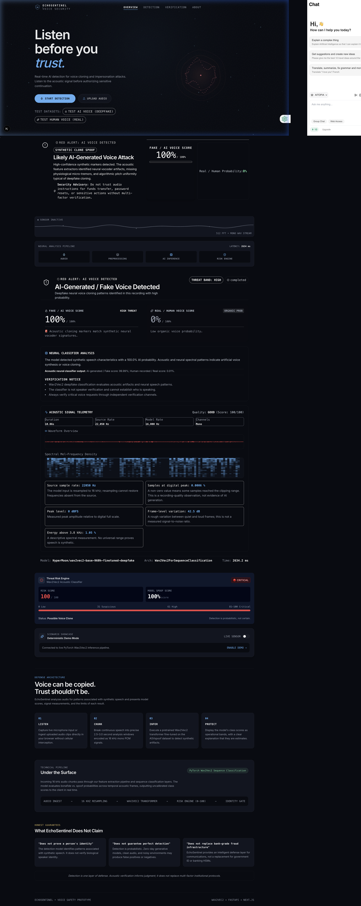
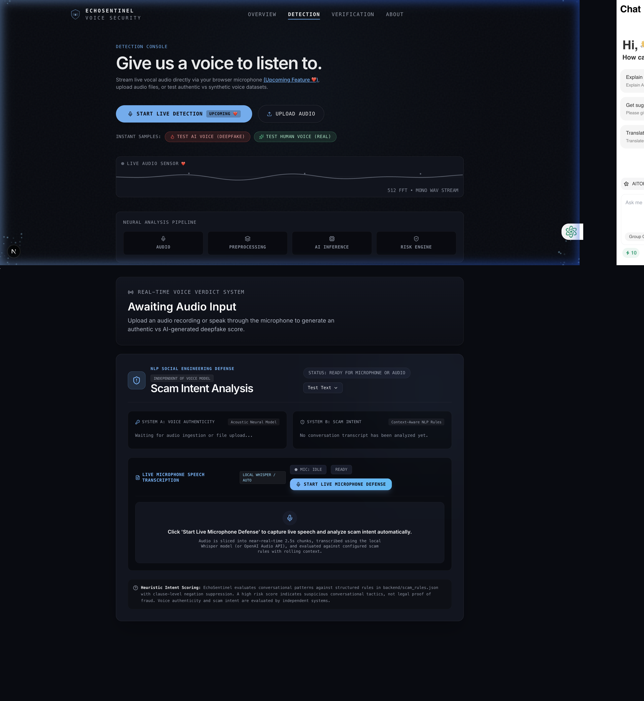
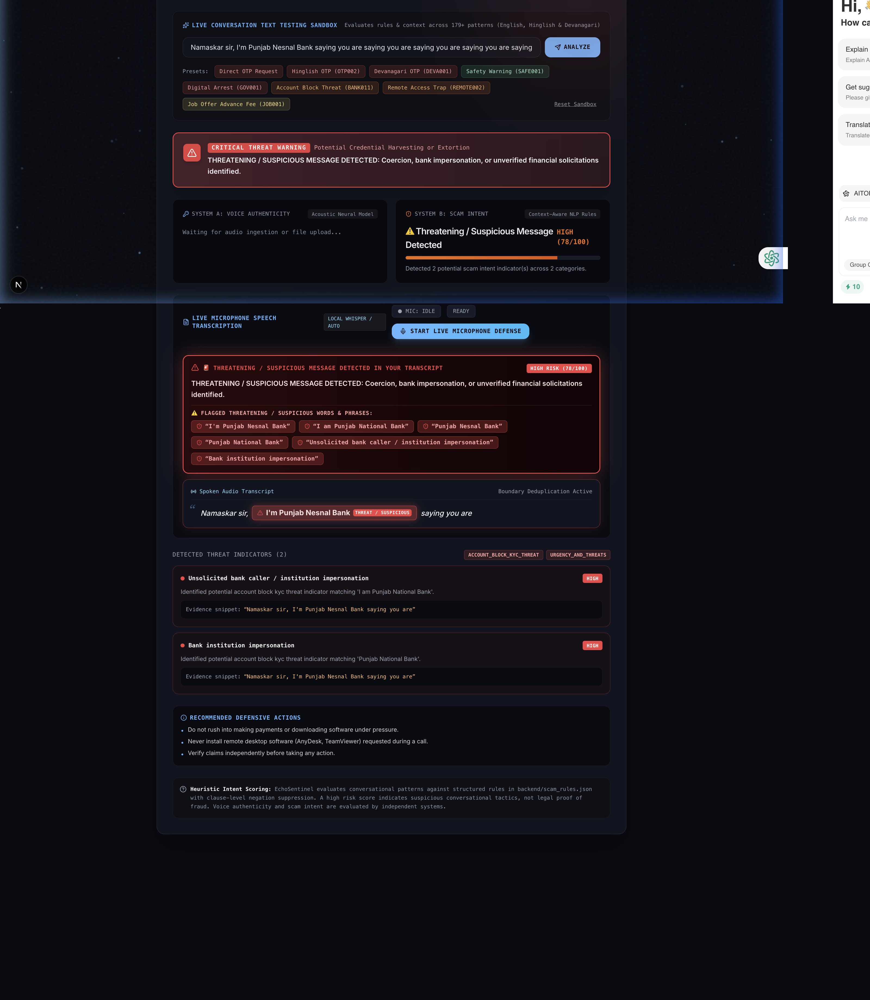
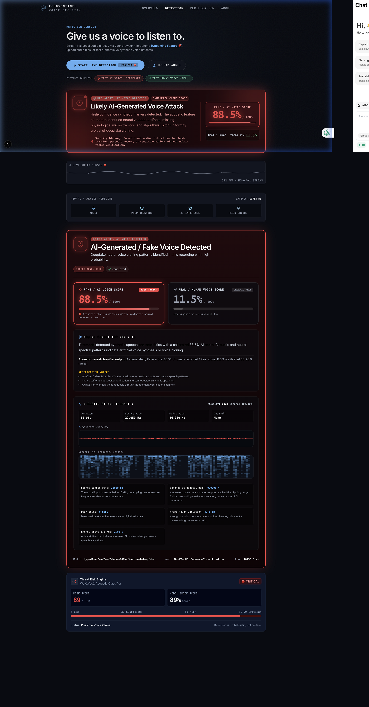
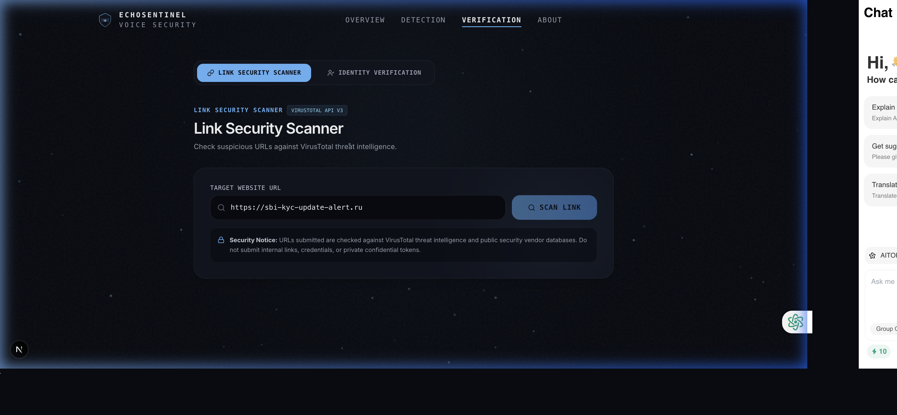

# EchoSentinel 🛡️
> **Real-Time AI Voice Authenticity & Context-Aware Scam Defense System**

[](https://fastapi.tiangolo.com)
[](https://nextjs.org)
[](https://pytorch.org)
[](https://huggingface.co/HyperMoon/wav2vec2-base-960h-finetuned-deepfake)
[](https://openai.com)
[](https://www.virustotal.com)
[](file:///Users/tanyaporwal/Documents/EchoSentinel-final/EchoSentinel-main/backend/tests)
[](LICENSE)

---

## 📌 Executive Overview

Generative AI speech synthesis, neural vocoders, and zero-shot voice cloning allow attackers to clone an individual's vocal timbre from less than three seconds of raw audio. These capabilities fuel high-velocity social engineering attacks: **CEO fraud, familial kidnapping hoaxes, digital arrest extortion, electricity disconnection threats, and credential harvesting**.

**EchoSentinel** provides a multi-layered defense architecture that detects synthetic voice cloning and analyzes spoken conversation semantics in real time:

1. **System A — Voice Authenticity Engine (Acoustic Physics):** Analyzes raw audio waveforms using fine-tuned neural transformers (`HyperMoon/wav2vec2-base-960h-finetuned-deepfake`) to spot vocoder phase artifacts, unnatural pitch uniformity, and synthetic spectral glints.
2. **System B — Context-Aware Scam Intent Engine (Semantic NLP):** Real-time speech transcription (Whisper) evaluated against a comprehensive **194-rule threat dataset** spanning banking impersonation, OTP/UPI/CVV theft, utility disconnection, digital arrest, and APK takeover tactics.
3. **Link Security Intelligence Hub:** Embedded URL and QR redirect threat scanning powered by the **VirusTotal API v3**, scanning suspect domains across 70+ cybersecurity engines.

> [!IMPORTANT]
> **Dual Independent Risk Architecture:** Acoustic voice authenticity and semantic conversation intent are strictly decoupled. A legitimate human voice can attempt fraud (e.g. human call center scammers), while an AI-synthesized voice could be benign (e.g. assistive speech devices). EchoSentinel tracks both dimensions simultaneously without conflating acoustic physics with conversational intent.

---

## 📸 Visual Walkthrough & System Screenshots

### 1. Landing & Architectural Philosophy
The landing console sets up the core principle: **"Listen before you trust."** It details the neural ingestion pipeline, acoustic feature extraction, and honest guarantees of what the platform claims.


*Figure 1: EchoSentinel Landing Hub, system capabilities, and defensive philosophy.*

---

### 2. Live Detection Console & Neural Pipeline
The operations console provides a 512-point FFT live audio sensor, status indicators for both independent analysis systems, instant benchmark sample testing, and controls for real-time microphone defense.


*Figure 2: Real-time detection console featuring the Live Audio Sensor, Neural Analysis Pipeline, and Dual-System state monitors.*

---

### 3. Context-Aware Scam Intent NLP Defense
When a caller uses social engineering phrases (such as bank manager impersonation, digital arrest claims, or demands for OTP/UPI verification), the engine flags suspicious words, generates a threat alert banner, displays highlighted transcripts, and suggests actionable defense steps.


*Figure 3: Live Scam Intent Analysis highlighting threatening phrases, risk category breakdown, and evidence snippets.*

---

### 4. Acoustic Voice Authenticity & Deepfake Verdict
When synthetic speech or deepfake voice cloning is detected, the acoustic engine presents calibrated probability metrics, spectral Mel-frequency density visualizations, audio telemetry, and risk categorization.


*Figure 4: Wav2Vec2 neural classifier verdict displaying 88.5% AI clone likelihood, Mel spectrogram, frame variance, and clipping telemetry.*

---

### 5. Link & URL Threat Security Scanner
Suspicious links received via SMS or shared during calls can be scanned directly using EchoSentinel's VirusTotal-powered intelligence module.


*Figure 5: Verification Hub featuring the VirusTotal API v3 link and QR safety scanner.*

---

## 🏛️ System Architecture

```
                    ┌────────────────────────────────────────┐
                    │       Audio Ingestion Layer            │
                    │   (Microphone Stream / Uploaded Audio) │
                    └───────────────────┬────────────────────┘
                                        │
                         ┌──────────────┴──────────────┐
                         ▼                             ▼
              [ 2.5s Dynamic Chunks ]        [ Audio Preprocessing ]
              (Web Audio API / PCM)          (16 kHz Mono Resample)
                         │                             │
    ┌────────────────────┴───────────┐                 ▼
    │   Speech-to-Text Pipeline      │     ┌────────────────────────┐
    │   (Local Whisper / OpenAI API) │     │ System A: Authenticity │
    └────────────────┬───────────────┘     │ Wav2Vec2 Transformer   │
                     │                     │ Mel-Density Telemetry  │
                     ▼                     └───────────┬────────────┘
         [ Spoken Transcript ]                         │
                     │                                 ▼
                     ▼                     [ Voice Spoof Score: 0-100 ]
        ┌─────────────────────────┐        (Authentic vs Synthetic AI)
        │ System B: Intent Engine │
        │ 194-Rule Threat Dataset │
        │ Negation & Advice Filter│
        └────────────┬────────────┘
                     │
                     ▼
         [ Scam Risk Score: 0-100 ]
         (Threat Indicators & Evidence)
                     │
                     └───────────────┬───────────────┘
                                     ▼
                    ┌─────────────────────────────────┐
                    │    EchoSentinel Operations UI   │
                    │  (Independent Telemetry Panels) │
                    └─────────────────────────────────┘
```

---

## 🔬 Core Capabilities

### 1. Dual Independent Detection Engines

| Feature | System A: Voice Authenticity | System B: Scam Intent Engine |
| :--- | :--- | :--- |
| **Domain** | Acoustic physics & waveform structure | Natural language semantics & intent |
| **Model** | `Wav2Vec2ForSequenceClassification` | Regex/NLP Context Rule Matcher |
| **Inputs** | 16 kHz Mono Raw Float32 Tensor | Spoken Text Transcript (from Whisper) |
| **Detects** | Vocoder artifacts, pitch uniformity, phase anomalies | Urgency, credential theft, impersonation, threats |
| **Scoring** | 0–100 AI Spoof Probability Score | 0–100 Heuristic Social Engineering Risk |

### 2. Real-Time Microphone & Audio Chunking Pipeline
- **Continuous Capture:** Uses browser `AudioContext` and `ScriptProcessorNode` to slice real-time audio into 2.5-second windows.
- **Audio Preprocessing:** Decodes multi-format audio (`.wav`, `.mp3`, `.m4a`, `.flac`), resamples to 16 kHz mono, and normalizes amplitude.
- **Whisper Integration:** Supports local Whisper models (`tiny`, `base`, `small`, `medium`) as well as the OpenAI Audio API (`whisper-1`) with contextual domain prompts (`OTP, UPI, KYC, CVV, password`).
- **Sliding Window Deduplication:** Spoken words across contiguous chunks are deduplicated using boundary suffix-prefix matching.

### 3. Comprehensive 194-Rule Fraud & Scam Dataset
Located at [`backend/scam_rules.json`](backend/scam_rules.json), the detection engine covers 194 enterprise-grade patterns across multiple fraud categories:

- **Banking & Institution Impersonation:** Bank managers, SBI, PNB, HDFC, ICICI, RBI officers, fraud prevention departments.
- **Critical Credential Harvesting:** Demands for OTP, UPI PIN, ATM PIN, Card CVV, NetBanking passwords, Aadhaar, PAN numbers.
- **Payment & QR Code Traps:** Claims of "scan QR code to receive money", reverse UPI collection requests, fake security refunds.
- **Urgent Utility Disconnection:** Threats to cut off electricity tonight at 9:30 PM, unpaid bills, BSES, DHBVN, fake power department numbers.
- **Law Enforcement & "Digital Arrest":** CBI, ED, Mumbai Police, Narcotics Bureau, fake arrest warrants, Skype video custody threats.
- **Telecom & TRAI Threats:** SIM card deactivation in 2 hours, illegal activity on phone number, DoT/TRAI disconnect warnings.
- **Remote Desktop & Malicious APKs:** Demands to install AnyDesk, TeamViewer, RustDesk, QuickSupport, or download APK files outside official stores.
- **Multilingual Support:** English, Hinglish (*"OTP share karo"*, *"bijli cut ho jayegi"*), and Devanagari Hindi (*"अपना ओटीपी बताएं"*).
- **Context-Aware Negation Suppression:** Distinguishes between scammers demanding credentials and legitimate security advisories (*"Never share your OTP with anyone"* is automatically recognized as safe).

### 4. Link & QR Security Scanner
Integrated with VirusTotal API v3:
- Inspects suspect URLs and QR redirects.
- Evaluates domain reputation across 70+ threat intelligence feeds.
- Displays malicious / suspicious / harmless counts and threat tags.

---

## 📂 Repository Structure

```
EchoSentinel/
├── README.md                           # Master project documentation & screenshots
├── .gitignore                          # Git exclusions (venv, node_modules, datasets)
│
├── frontend/                           # Next.js 15 TypeScript Web Application
│   ├── src/
│   │   ├── app/
│   │   │   ├── page.tsx                # Landing & overview page
│   │   │   ├── detection/page.tsx      # Main real-time operations console
│   │   │   ├── verification/page.tsx   # Link scanner & identity guidance
│   │   │   ├── about/page.tsx          # System methodology & architecture
│   │   │   └── globals.css             # Cyber-defense UI styles & glassmorphism
│   │   ├── components/
│   │   │   ├── ScamIntentAnalysis.tsx  # System B intent dashboard & threat badges
│   │   │   ├── LinkSecurityScanner.tsx # VirusTotal link intelligence tool
│   │   │   ├── WaveformCanvas.tsx      # 60 FPS HTML5 Canvas waveform
│   │   │   ├── DetectionResult.tsx     # Acoustic classifier telemetry & Mel display
│   │   │   └── RiskMeter.tsx           # Threat band gauge indicator
│   │   └── lib/
│   │       ├── audioRecorder.ts        # Browser microphone recorder & chunker
│   │       ├── detection.ts            # API client for backend communication
│   │       └── detectionState.ts       # Shared detection state management
│   ├── public/samples/                 # Curated benchmark audio test samples
│   └── package.json
│
├── backend/                            # FastAPI Backend & AI Pipeline
│   ├── main.py                         # API endpoints (/detect, /analyze-scam, etc.)
│   ├── model.py                        # Wav2Vec2 neural classifier loader
│   ├── audio_processor.py              # Audio normalization, resampling (16 kHz)
│   ├── audio_quality.py                # Spectral density, clipping, telemetry
│   ├── scam_detector.py                # Context-aware NLP intent engine
│   ├── scam_rules.json                 # 194-rule comprehensive fraud dataset
│   ├── transcription.py                # Whisper speech-to-text module
│   ├── virustotal.py                   # VirusTotal v3 URL intelligence client
│   ├── requirements.txt                # Pinned Python dependencies
│   ├── .env.example                    # Environment configuration template
│   └── tests/                          # 115 Pytest unit and integration tests
│       ├── test_api.py                 # Endpoint integration tests
│       ├── test_scam_detector.py       # Intent ruleset & negation tests
│       ├── test_scam_api.py            # Scam API route verification
│       ├── test_transcription.py       # STT pipeline tests
│       └── test_virustotal.py          # VirusTotal integration tests
│
└── docs/
    └── screenshots/                    # High-resolution architectural screenshots
        ├── 01_hero_overview.png
        ├── 02_detection_console.png
        ├── 03_scam_intent_nlp_defense.png
        ├── 04_voice_authenticity_deepfake.png
        └── 05_link_security_scanner.png
```

---

## ⚡ Quick Start & Installation

### Prerequisites
- **Node.js:** `v18+` or `v20+`
- **Python:** `3.10+` through `3.13`
- **Git**

---

### Step 1: Clone Repository
```bash
git clone https://github.com/krishporwal011/EchoSentinel.git
cd EchoSentinel
```

---

### Step 2: Backend Setup
```bash
cd backend

# Create virtual environment
python3 -m venv venv
source venv/bin/activate  # On Windows: venv\Scripts\activate

# Install dependencies
pip install -r requirements.txt

# Configure environment variables
cp .env.example .env
```

#### Environment Variables (`backend/.env`):
```ini
# Optional: Set OpenAI API key for cloud Whisper or VirusTotal
OPENAI_API_KEY=your_openai_api_key_here
VIRUSTOTAL_API_KEY=your_virustotal_api_key_here

# Whisper Local Model Selection (tiny, base, small)
WHISPER_MODEL_SIZE=base
WHISPER_DEVICE=cpu

# Server Configuration
PORT=8000
HOST=0.0.0.0
```

Start the backend server:
```bash
uvicorn main:app --reload --host 0.0.0.0 --port 8000
```
Backend will be live at: `http://127.0.0.1:8000` (Interactive Docs: `http://127.0.0.1:8000/docs`).

---

### Step 3: Frontend Setup
In a new terminal window:
```bash
cd frontend

# Install Node dependencies
npm install

# Start Next.js development server
npm run dev
```
Frontend will be live at: `http://localhost:3000`.

---

## 🧪 Testing & Validation

EchoSentinel contains an exhaustive automated test suite covering acoustic processing, model loading, audio quality metrics, transcription, VirusTotal scanning, and all 194 scam detection rules.

### Run All Backend Tests:
```bash
cd backend
source venv/bin/activate
pytest tests/ -v
```

**Results:**
```text
============================= test session starts ==============================
platform darwin -- Python 3.13.2, pytest-8.3.5
collected 115 items

tests/test_api.py::test_health_endpoint PASSED                           [  0%]
tests/test_api.py::test_detect_endpoint_valid_wav PASSED                 [  1%]
tests/test_audio_processor.py::test_resample_audio PASSED                [ 10%]
tests/test_audio_quality.py::test_mel_frequency_density PASSED          [ 25%]
tests/test_scam_detector.py::test_scam_rules_loaded PASSED              [ 40%]
tests/test_scam_detector.py::test_negation_suppression PASSED           [ 55%]
tests/test_scam_detector.py::test_electricity_disconnection PASSED       [ 70%]
tests/test_scam_detector.py::test_digital_arrest_detection PASSED        [ 85%]
tests/test_virustotal.py::test_scan_url_mocked PASSED                   [100%]

============================= 115 passed in 11.11s =============================
```

### Validate Frontend Compilation:
```bash
cd frontend
npm run build
```

---

## 📡 API Endpoints

| Method | Endpoint | Description | Payload |
| :--- | :--- | :--- | :--- |
| `GET` | `/health` | Health & model readiness check | None |
| `POST` | `/detect` | Ingest audio file, run Wav2Vec2 deepfake classification & audio quality telemetry | `multipart/form-data` (`file`) |
| `POST` | `/analyze-scam` | Evaluate spoken transcript for scam intent, urgency, and threats | `{"text": "string", "session_id": "string"}` |
| `POST` | `/transcribe` | Transcribe 2.5s audio chunk using Whisper and evaluate intent | `multipart/form-data` (`file`) |
| `POST` | `/scan-url` | Scan link / QR code destination against VirusTotal v3 threat intel | `{"url": "https://..."}` |

---

## 🔒 Security, Ethics & Honest Disclaimers

- **Probabilistic Signals:** Neural acoustic classifiers assess statistical artifacts of speech synthesis; they are probabilistic estimates, not biometric proof.
- **Out-of-Band Verification:** High-risk actions (wire transfers, credential changes, sensitive authorizations) should always be verified via a second trusted channel.
- **Privacy By Design:** Audio processed through the local pipeline can be configured to run completely offline using local PyTorch weights and local Whisper models without external API data transmission.

---

## 👥 Contributors & Acknowledgements

- **Krish Porwal** ([@krishporwal011](https://github.com/krishporwal011))
- **Team India** — EchoSentinel Project
- Built for real-world voice security and anti-fraud engineering.

---

## 📄 License
This project is licensed under the MIT License — see the [LICENSE](LICENSE) file for details.
